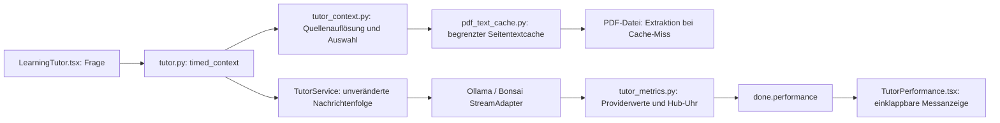

# Lokale KI-Modelle: Architektur des Anfragewegs (IST und SOLL)

Stand: 12.11.2026, **Zwischenstand während der Umsetzung**. Abschnitte mit „geplant“ sind noch nicht umgesetzt oder noch nicht gemessen. Messwerte stehen in [llm-performance-results.md](llm-performance-results.md).

Rücksetzpunkt vor Beginn der Arbeiten: Commit `3bdca3e` (Arbeitsverzeichnis war sauber).

## 1. IST: Weg einer Lernfrage (Stand `3bdca3e`)

```
Browser                         Hub (FastAPI, ein Prozess)                          Modelllaufzeit
───────                         ──────────────────────────                          ──────────────
TutorPage.tsx
 └ TutorWorkspace (LearningTutor.tsx)
    │ GET /api/tutor/context ─► tutor.py  selected()                                 –
    │   (Vorschau, ohne Frage)    └ tutor_context.py  build_tutor_context()
    │                                ├ learning_pages.load_learning_pages()   liest content/*.json (jedes Mal)
    │                                ├ _CuratedContext            kuratierte Texte, Quellen-IDs S1…S8
    │                                └ _pdf_excerpts()            bis 5 PDF-Seiten, passende Passagen (pypdf, jedes Mal)
    │
    │ POST /api/tutor/chat/stream ─► tutor.py  chat_stream()
    │   {module, goal, message,       ├ validate_chat()           Grenzen: 4.000 Zeichen, 12 Verlaufsbeiträge
    │    history, think}              ├ selected()                Kontext NEU bauen, jetzt MIT der Frage
    │                                 │   ├ tutor_assignments.select_question()   (Einsendearbeit erkannt?)
    │                                 │   ├ build_tutor_context(message, history, focus=Lernziel)
    │                                 │   └ Lernziel: Lernstand aus learning_memory VOR den Kontext gesetzt
    │                                 ├ TutorService._prepare()   Budget in Bytes, Verlauf kürzen, Anfrage bauen
    │                                 └ TutorService._stream_events()
    │                                     ├ _generation-Sperre (ein Modellaufruf zur Zeit)
    │                                     ├ _local_check()        /api/tags + /api/show (≈ 30 ms)
    │                                     ├ Ollama:  POST 127.0.0.1:11434/api/chat  ───────► Ollama 0.35.0, MLX-Runner
    │                                     │  Bonsai: POST 127.0.0.1:8081/v1/chat/completions ► mlx-vlm-Server (eigener Prozess)
    │                                     │          └ bonsai.StreamAdapter  SSE → NDJSON
    │ ◄── NDJSON: thinking… delta… done   ├ je Zeile: thinking / delta weiterreichen
    │                                     ├ _finish()             Quellen, Auszüge, Hinweise
    │                                     └ quality.check_tutor() feste Prüfung, Befund anhängen
    └ streamChat(): erster delta = „Antwortbeginn“, done = „Antwortzeit“ (nur Browser-Uhr)
```

### Aufbau der Modellanfrage (Ollama)

| Nr. | Rolle | Inhalt | Hängt ab von |
|---|---|---|---|
| 1 | system | `TUTOR_INSTRUCTIONS` (4.098 Zeichen) | nichts (fest) |
| 2 | user | `CONTEXT_PREAMBLE` + Kontexttext: Lernziel und **Lernstand**, kuratierte Texte, Quellenliste, **PDF-Passagen**, Endmarke, Beleg-Hinweis | Auswahl, **Lernstand**, **aktueller Frage** |
| 3…n | user/assistant | Gesprächsverlauf (vom Browser, höchstens 12 Beiträge und 18.000 Zeichen, gleitendes Fenster) | Gespräch |
| n+1 | user | aktuelle Frage (bei „Länger nachdenken“ zusätzlich Bilder) | Frage |

Parameter: `num_ctx` aus `context_tokens` (32.768), `num_predict` 1.400 (mit Nachdenken 6.144), `keep_alive` 15 Minuten, `think` nur auf Wunsch. Temperatur und Seed setzt der Hub nicht.

### Vorhandene Caches und Messpunkte (IST)

| Ort | Was | Bemerkung |
|---|---|---|
| Ollama (MLX-Runner) | Prompt-Cache im Arbeitsspeicher des Runners | Verhalten siehe Abschnitt 2; geht beim Entladen verloren |
| Bonsai (`bonsai.py`) | `APC_ENABLED=1`, Checkpoints alle 512 Tokens, nur im RAM | seit dem Einschalten am 09.11. lief laut Laufzeit-Log keine Anfrage; Wirkung bisher unbelegt |
| Hub | `pdf_figures` Bild-Cache (`data/figure-cache`) | nur für „Länger nachdenken“ |
| Hub | kein Cache für Lernpakete und PDF-Seitentexte | Kontextaufbau 0,1–0,5 s je Anfrage |
| Browser | „Antwortbeginn“ und „Antwortzeit“ je Antwort, Verlauf in `localStorage` | einzige Messung; Ollama-Statistiken verwirft der Hub |
| `tools/bench_tutor_models.py` | Prefill und Decode getrennt, drei Läufe | misst an Ollama direkt, nicht den Weg durch den Hub |

## 2. Nachgewiesenes Cache-Verhalten von Ollama 0.35.0 mit `qwen3.8:27b-mlx`

Gemessen am 12.11.2026 über den echten Anfrageweg (Tabelle in den Ergebnissen).

1. Ollama meldet `prompt_eval_count` (gesamter Prompt) und `prompt_eval_cached_count` (davon wiederverwendet). `prompt_eval_duration` deckt nur die neu gelesenen Tokens ab.
2. **In der Baseline trafen identische und fortgesetzte Anfragen den Cache; eine andere Frage im neuen Gespräch nicht.** Test C: 13.524 von 13.612 Zeichen gleich, trotzdem 0 wiederverwendete Tokens. Eine allgemeine Regel „nur vollständige Verlängerungen treffen“ ist damit nicht bewiesen: Das spätere Vorladeexperiment zeigt auch bei einer anderen Frage einen großen Treffer. Checkpoint-Grenzen und Verdrängung müssen kontrolliert untersucht werden.
3. **Es bleiben mehrere Zustände erhalten.** Die Rückkehr zu einem früheren Prompt nach fünf anderen Anfragen traf den Cache vollständig (Test D2: 3.440 von 3.441).
4. Die erzeugte Antwort wird bei der Folgefrage manchmal mitverwendet (Test C3: nur 31 neue Tokens), manchmal neu gelesen (Test C2: 291 neue Tokens). Der Prompt davor bleibt in beiden Fällen im Cache.
5. Entladen des Modells (Modellwechsel, 15 Minuten Leerlauf) löscht den Cache (Test E2).

## 3. Nachgewiesene Schwachstellen (IST)

| Nr. | Schwachstelle | Nachweis | Folge |
|---|---|---|---|
| S1 | Die PDF-Passagen in Nachricht 2 hängen von der aktuellen Frage ab. Ändert die Frage die Auswahl, ändert sich der Prompt weit vorn. | Offline-Vergleich: 10 von 110 Kombinationen aus Lernziel und Frage (9 %) ergeben einen anderen Kontexttext; gemeinsamer Anfang dann nur 2.554–7.381 Zeichen. | Folgefrage wird vollständig neu gelesen (75–100 s statt 2–8 s). Erklärt den Widerspruch 08.11./09.11. (siehe Ergebnisse). |
| S2 | Die ersten Fragen A, C, D1 und M1 waren in der damaligen Baseline kalt. Andere neue Fragen können Präfixe wiederverwenden (Live-Pilot). | Tests A, C, D1, M1: 73–99 s bis zum ersten Text, 0 Tokens aus dem Cache. | Größter Einzelposten der Wartezeit. |
| S3 | Der Browser kürzt den Verlauf gleitend (ältestes Paar fällt je Frage weg, sobald mehr als sechs Paare). Der Server kürzt nach Bytebudget ebenfalls gleitend. | Code: `requestHistory()` in `LearningTutor.tsx`, Schleife in `_prepare()`. Der veränderte Verlauf kann die Wiederverwendung begrenzen; vollständiges Neulesen ab dem siebten Paar ist nicht nachgewiesen. | Lange Gespräche werden bei jeder Frage kalt. Noch nicht gemessen. |
| S4 | Der Lernstand (Selbsteinschätzung, fällig, Notiz) steht am Anfang von Nachricht 2. | Code: `selected()` in `tutor.py`. | Speichern einer Selbsteinschätzung kann die Wiederverwendung des Kontexts begrenzen; der Effekt ist noch zu messen. |
| S5 | Der Hub verwirft alle Statistiken von Ollama und Bonsai. | Code: `_stream_events()` las nur `message` und `done`. | Cache-Treffer und Lesegeschwindigkeit waren im Hub nicht sichtbar. |
| S6 | Ein verwaister Bonsai-Server belegt 8,5 GB neben dem geladenen Qwen (18 GB), laut damaliger Prozessaufnahme. | `footprint`: Prozess 55524 seit 09.11., Elternprozess 1; Swap 21–25 GB belegt. Ursache: `start_new_session=True`, Aufräumen nur beim geordneten Beenden des Hubs. | Speicherdruck, Auslagerung; der Wechsel zu Bonsai scheitert außerdem an „Port 8081 wird bereits verwendet“. |
| S7 | Bonsai liefert Token- und Cache-Zahlen im Stream nur auf Anforderung (`stream_options.include_usage`); der Hub forderte sie nicht an. | Laufzeit-Quelltext `mlx_vlm/server/openai.py`. | Keine Cache-Messung für Bonsai möglich. |
| S8 | Die Lesegeschwindigkeit fiel innerhalb von 25 Minuten Dauerlast von 47 auf 38 Tokens/s; thermische Drosselung ist eine mögliche, nicht isoliert nachgewiesene Ursache. | Baseline A → M1. | Messungen müssen die Reihenfolge und Abkühlpausen berücksichtigen. |
| S9 | Lernpakete und PDF-Seiten werden bei jeder Anfrage neu gelesen und geprüft. | Zeitmessung `/api/tutor/context`: 0,09–0,46 s. | Klein gegenüber dem Prefill, aber bei Cache-Treffern ein spürbarer Anteil. |

Keine Schwachstelle: Die Reihenfolge der Nachrichten (fester System-Prompt zuerst) ist bereits cachefreundlich. Thinking verzögert die sichtbare Antwort nur, wenn es eingeschaltet ist; der Hub schaltet es standardmäßig aus (`think: false`).

## 4. Frühere Optimierungsideen (noch nicht umgesetzt)

1. **Stabiler Kontext je Auswahl:** Nachricht 2 hängt nur noch von der Auswahl (Lernziel, Lernseite, Abschnitt) ab, nicht von der Frage. Das könnte Präfixe stabilisieren; Verlaufskürzung, Lernstand und Chat-Templates bleiben weitere Einflussgrößen.
2. **Frageabhängige Passagen hinten:** Zur Frage passende Stellen, die im stabilen Kontext fehlen, kommen als eigene Nachricht direkt vor die Frage und bleiben im Verlauf an derselben Stelle (der Hub berechnet sie für frühere Fragen identisch neu).
3. **Vorladen:** Beim Öffnen eines Lernziels liest das Modell System-Prompt und stabilen Kontext, bevor die erste Frage kommt. Abschaltbar; standardmäßig nur aktiv, wenn die Messung einen Vorteil zeigt.
4. **Verlauf blockweise kürzen:** Browser und Server kürzen in Blöcken von drei Paaren statt gleitend.
5. **Messwerte bis in die Oberfläche:** `backend/tutor_metrics.py` (umgesetzt) liefert je Antwort einen Datensatz `performance`; die Oberfläche zeigt ihn einklappbar.
6. **Verwaiste Bonsai-Prozesse** beim Start erkennen.


## 5. Fortsetzung: umgesetzte Erweiterungen am 12.11.2026

Die bestehende Route, Gesprächsreihenfolge, Modellauswahl und frageabhängige Passagenauswahl bleiben erhalten. Der neue Datenfluss ergänzt die obige Architektur:



### Entscheidung: Extraktion wiederverwenden, Promptänderungen vertagen

**Status:** umgesetzt für den PDF-Textcache; Prompt-Prefill und Umordnung offen.
**Datum:** 12.11.2026.

Die Alternativen waren (a) begrenztes Wiederverwenden unveränderter PDF-Seitentexte, (b) Trennung von stabilem Basiskontext und dynamischen Passagen, (c) Modell-Prefill beim Öffnen eines Lernziels. Alternative a lässt den Prompt identisch und ist offline prüfbar. Bei b müssten historische RAG-Passagen samt Quellen-IDs reproduzierbar bleiben; bloßes Neuberechnen kann nach Dateiänderungen die Gesprächsgrundlage verändern. Bei c fehlt ein kontrollierter, wiederholbarer Nachweis für die erste Frage. Deshalb ist nur a aktiviert.

- Der Cache hält höchstens 256 Seiten bzw. 4 MiB UTF-8-Text plus Python-Verwaltungsaufwand. Er speichert keine Reader, Dateihandles, Modellzustände oder Antworten.
- Einträge sind höchstens 120 Sekunden nutzbar; abgelaufene Einträge werden beim nächsten Zugriff entfernt. Es läuft kein Hintergrunddienst. Ohne weitere Zugriffe bleiben die begrenzten Textdaten bis zum Prozessende im RAM.
- Vor jedem Treffer wird die Quelle erneut über die bestehende Pfadprüfung aufgelöst. Geräte-/Inode-ID, Größe, Änderungs- und Metadatenzeit invalidieren bearbeitete oder ersetzte Dateien. Änderungen während einer Extraktion werden als Quellenfehler behandelt.
- `MLH_PDF_TEXT_CACHE=0` deaktiviert die Wiederverwendung. Explizite Seiten-/Abbildungssuchen in `_requested_pages` bleiben unverändert; diese Vorab-Suche wird noch nicht gecacht.
- Keine zusätzliche Bibliothek, keine Änderung der Zeichenbudgets oder Quellennummerierung.

### Messvertrag

`done.performance` enthält vorhandene Providerstatistiken oder `null`. Hub-TTFT beginnt vor `_local_check`, nach Kontextaufbau und Promptvorbereitung. Thinking zählt zum ersten Token, erst nicht-leerer sichtbarer Text zur TTFT. Der Browser misst separat vom Absenden bis zum Eingang des ersten sichtbaren Texts; das ist keine Messung des tatsächlichen Bildschirm-Paints. `context_seconds` misst den Kontextaufbau separat. `total_seconds` endet vor den diagnostischen Speicherabfragen. Die Browser-Antwortzeit enthält auch deren Wartezeit und die anschließende Qualitätsprüfung.

Ollama meldet Prompt-/Cache-/Ausgabe-Tokens und Laufzeiten. Die Lesegeschwindigkeit verwendet nur neue Tokens; ohne Cache-Zahl bleibt sie unbekannt. Bonsai erhält `stream_options.include_usage`; sein Adapter wartet nach dem Stop-Chunk auf Usage/Timings. Bei Cache-Treffern bleiben dort Prefill-Dauer und Prefill-Rate wegen der abgeleiteten Laufzeitberechnung unbekannt; Peak-Memory wird aus dezimalen GB in Bytes umgerechnet. Nicht gemeldete Werte werden nicht aus Streamstücken oder TTFT geschätzt. NaN/Infinity werden verworfen. Speicherbelegung und Speicherdruck sind Momentaufnahmen nach der Antwort, keine Prozess-RSS-Messung. Peak-Memory kann eine Laufzeitspitze statt einer anfragespezifischen Spitze sein.

### Dateien und Implementierungsstand

| Bereich | Dateien | Stand |
|---|---|---|
| Provider und Messung | `backend/tutor.py`, `backend/tutor_metrics.py`, `backend/bonsai.py` | übernommen, ergänzt, getestet |
| Wiederholte PDF-Extraktion | `backend/pdf_text_cache.py`, `backend/tutor_context.py` | umgesetzt, Vergleich mit echten Kontexten |
| Chat-Anzeige | `frontend/src/TutorPerformance.tsx`, `LearningTutor.tsx`, `learning-tutor.css` | umgesetzt, Build und Rendering-Tests |
| Modellbenchmark | `tools/bench_tutor_models.py` | korrekte Statistiken, 30-Fragen-Modus, JSONL-Zwischenstände, Modellwahl |
| Fragen/Promptvorbereitung | `tools/prepare_tutor_benchmark.py` | 30 Fragen, echte Hub-Route ohne Modellaufruf, Datenbankkopie |
| Tests | `tests/test_tutor_metrics.py`, `test_pdf_text_cache.py`, `test_bench_tutor_models.py`, `frontend/tests/tutor-performance.test.mjs` | ergänzt |

Der laufende private Hub auf Port 8000 und seine Konfiguration wurden in dieser Fortsetzung nicht verändert. Änderungen liegen im Entwicklungscheckout; eine Übernahme dorthin ist noch offen.


## 6. Live-Pilot nach Freigabe des lokalen Zugriffs

Drei identische Fragen mit je einer Wiederholung wurden auf Bonsai, Qwen 27B und Qwen 9B ausgeführt. Der Bonsai-Präfixcache ist damit live belegt. Die Daten erlauben keine allgemeine Regel, dass andere Fragen immer kalt werden. Das Verhalten hängt vom konkreten Prompt und Laufzeitzustand ab. Messwerte, Ausgangszustände und erste Qualitätsbefunde stehen im [Live-Bericht](llm-live-pilot-2026-11-12.md). Die Anwendungslogik und Standardmodellauswahl wurden dabei nicht geändert.
